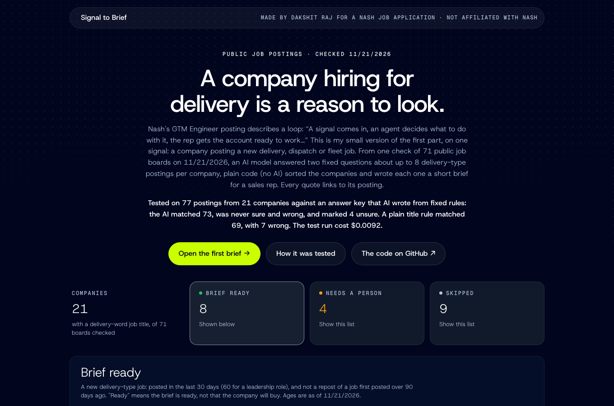
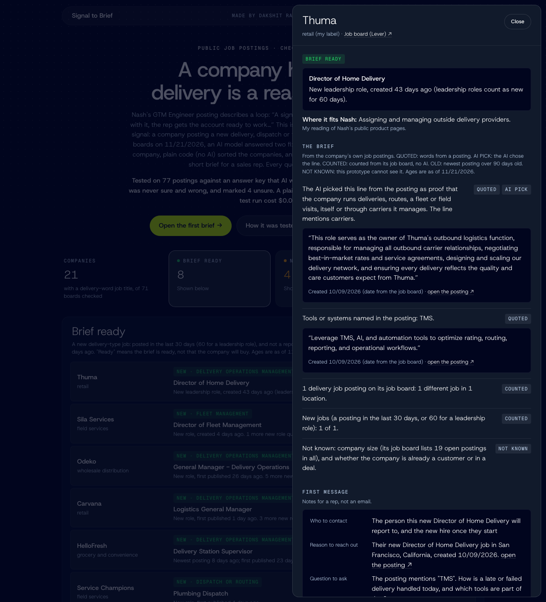
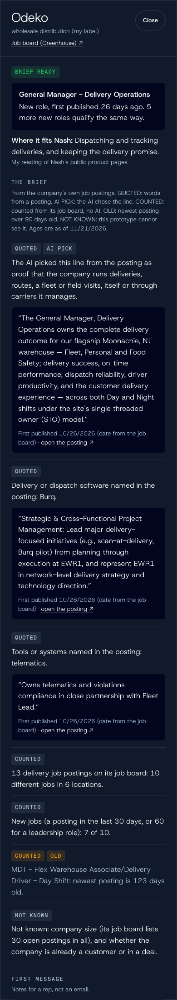

# Signal to Brief

Signal to Brief turns a company's new delivery hiring into a short brief for a sales rep. It checked 71 public job boards from 70 companies once, on 11/21/2026. Where a company had posted a delivery, dispatch, fleet, logistics, transportation or field-technician job, it wrote a brief about that company. Quoted lines show their posting and date, including any tools or systems the posting names, and counts are made by plain code from the board. Leadership hires, such as a new director of delivery, come first, on the guess that the person hired is close to whoever chooses delivery tools; among them, the hire that stands out most at its company comes first. Each company lands in one of three groups, with the reason on the row:

- **Brief ready:** a delivery-type job posted in the 30 days before the check (60 days for a leadership role), and not a repost of a job first posted more than 90 days before. "Ready" means the brief is ready, not that the company will buy.
- **Needs a person:** something is unclear, and the row says what. For example, the AI was unsure, a job's place says only "Remote", or four in five dates on the board are no more than 14 days apart.
- **Skipped:** the rule that ruled it out, such as "nothing new" or "read as other work".

Nash's GTM Engineer posting describes a loop where a signal comes in, something decides what to do with it, and the rep gets the account ready to work. This is my small version of the first part of that loop, on one kind of signal. It does not learn from outcomes.

I made this to apply for Nash's GTM Engineer role. It is an unofficial prototype and is not affiliated with Nash. The companies, job titles, places, dates and quoted lines are real, from public job postings. One check of 71 boards on 11/21/2026 made the page's data; the boards were also read while I made the list and tested the rules. I left out the companies I could find that Nash names in public. For the 21 companies shown, who owns each was also looked up; none is owned by one of those companies (five owners could not be fully confirmed, and for the 1-800-GOT-JUNK board only the brand's owner was looked up, not the franchise group that runs it).

**The page:** https://duckky153.github.io/signal-to-brief/



## What's on the page

- **The four cards at the top:** 21 companies with a delivery-type job title, out of 71 boards. 8 are Brief ready, 4 need a person, 9 are skipped. Click a group card to see its companies.
- **A company's brief:** click Open on any row. You'll see the reason first. Then the brief, where each line has a tag:
  - QUOTED: words from the company's own posting, shown exactly, with the posting's date and a link. When the line comes from a different posting than the job the row is about, it says which.
  - AI PICK: the line the AI chose as proof that the company runs deliveries.
  - COUNTED: a count made by plain code from the board.
  - OLD: a job whose newest posting is more than 90 days old.
  - NOT KNOWN: what this prototype can't see, such as company size (the line gives the board's open postings as a rough guide) or whether the company is already a customer.
- **First message:** notes for a rep, not an email: who to contact (the person named in the posting's reporting line when it has one), the reason to reach out (the new posting itself), one question tied to the hire and to any tools the posting names (delivery or dispatch software gets its own question), and what not to assume. Under each reason, a line says where the hire fits Nash, which is my reading of Nash's public product pages. On a Needs a person company with a job that could be worked, the notes say "if a person decides it is fine". Copy the notes copies them with the company and the posting link. Nothing is sent.
- **Your call:** buttons a rep can press, such as Worked it or Not a fit, with a reason. The choice is kept only in your browser. In real use, these choices are the labels that would correct the rules.
- **How it was tested:** the scores, the AI's two questions, how each company is sorted, every disagreement between the answer key and the second AI, and every change made after the rules were frozen.





## What's AI here, and what isn't

One step uses AI. Jev, TypeSafe's model, reads one posting per delivery-type job (its newest posting in the US, or its newest if none is in the US; leadership jobs first; at most 8 jobs per company) and answers two fixed questions:

1. "Does the employer that wrote this posting deliver goods, run routes, dispatch drivers or technicians, keep a fleet of vehicles for delivering goods or for visits to customers, or send workers out to customers to install, repair, service, pick up or deliver things? It counts when it does this with people or vehicles it employs or directs, or when it delivers its own goods to its customers or between its own sites through outside freight or parcel carriers or delivery partners that it chooses, schedules or manages. Carrying passengers is not delivering goods." It also points to the line in the posting that shows it.
2. What is this job mainly? It picks one of 8 kinds of work.

It picks from fixed answers with a probability for each. It writes no text. An answer counts as sure at 0.80 or more; below that it is unsure. An unsure answer sends the company to a person only when the job could still qualify for Brief ready. A pointed line is used only when the first answer is a sure yes and the line's own probability is 0.20 or more.

Everything that decides is plain code: the title words, the dates, which postings are copies of the same job, the group and the order. The lines naming tools and who a job reports to are also found by plain code, from a fixed word list. The page never calls the model. It reads the saved answers.

What the AI adds, honestly: with the title rule's yes or no in place of the AI's answers, 20 of the 21 companies land in the same group, and for the one that differs, Natera, the title rule sorts it the way the answer key does. The AI's part is the proof and the doubt: it picked a line the answer key counts as proof on 70 of 72 postings, which a title rule cannot do, and it says unsure instead of guessing.

## Two versions

This is version 2. Version 1 read only delivery, dispatch, driver, courier and fleet titles. An AI review of version 1, written from a growth lead's point of view, said its briefs leaned on driver jobs and missed the people who buy: Carvana's brief stood on a tow-truck driver while it was hiring logistics managers, and a Director of Home Delivery created 43 days before the check, whose posting says it manages "all outbound carrier relationships", was skipped. So version 2 also reads logistics, transportation, routing, route and field-technician titles. It counts delivery through carriers a company manages, gives leadership roles 60 days to count as new, and sends an unsure answer to a person only when it could change the result.

Version 2 was written after version 1's results were seen, and 53 of its 78 test postings were also in version 1, so it is not an independent first look. Some of its choices came from those results: the words "freight or parcel carriers" echo the Director of Home Delivery posting, and the 60-day window and the narrower unsure rule came from reviews of that posting and of a training-design job. Its rules were frozen again before its one test run. Split by overlap: on the 52 counted postings also in version 1, the AI matched 51 (1 unsure) and the title rule 50 (2 false alarms); on the 25 new ones, the AI matched 22 (3 unsure) and the title rule 19 (3 missed, 2 false alarms, 1 unsure). Version 1's numbers are in `CHANGES.md`.

## How it was tested

- **The set:** 78 postings from the 21 companies, the ones the model read.
- **The answer key:** written from one written rules file (`data/LABEL-RULES.md`, version 3) by AI helpers that saw only the rules and the postings, before version 2's test run. The model had read 53 of these postings in version 1's run; no key writer saw a model answer. No person labeled the postings.
- **A second labeling:** a second AI, from a different company, labeled all 78 without seeing the key. The two agreed on 76 of 78 for question 1 and 74 of 78 for question 2. Of the 6 disagreements, the written rules settled 2; on the other 4 the rules were unclear, and the key's answer was kept. Where an unsettled answer could change a score, that posting is left out of that score; I added that to the scorer after version 1's run, as my plan for the scoring called for, and the page shows the counts on all 78 beside it. All 6 disagreements are listed on the page.
- **Practice:** the questions were tested on 30 practice postings from other companies, drawn again for version 2, never shown or scored. Question 1 was reworded once, to use the rules' own words for carriers and to say carrying passengers is not delivering goods. With that wording, question 1 sat exactly at two of my limits: sure but wrong on 3 of 30, and changed on 3 of 30 when the answer options were put in reverse order. Every wrong answer was on a shipping posting.
- **Frozen first:** the postings, the rules, the questions, the thresholds, the key, the sorting code and the scorer were fingerprinted before the one test run. The fingerprints and every later change, with its reason and which way it moved each count, are in `site/data/lock.json` and on the page. A test checks that each logged change follows the one before.
- **Is this delivery, dispatch or fleet work at a company that runs it?** Counted on 77 of the 78 (1 left out as above). The AI: 73 match the key, 0 missed, 0 false alarms, 4 unsure. A plain title rule with no AI: 69 match, 3 missed, 4 false alarms, 1 unsure. Always giving the common answer: 67 match, 10 false alarms. Counting all 78: the AI 74 / 0 / 0 / 4, the title rule 70 / 3 / 4 / 1. The title rule was written while planning with every title in view, which favors the rule; for version 2 it treats the new title words like "delivery", except that an analyst title counts as not delivery work and a field technician counts as delivery work unless the department is technical.
- **The quote it picked:** where the key says yes and lists the lines that would prove it (2 left out as above), 70 were good proof, none was wrong, and on 2 it picked no line. The key's lists are generous, which makes this easier to pass.
- **The groups:** with the model, 8 / 4 / 9. With the answer key in place of the model, 8 / 3 / 10. The page lists where they differ and why.
- **Limits:** 78 postings from 21 companies is a small set. These are counts, not rates. I chose the companies and the title words. Two different titles for the same job count as two jobs, and a job's older copies are counted anywhere at the company. Whether delivery hiring leads to buying is not tested here; only won and lost deals can test that. Not built: finding people, sending, replies, learning from outcomes.
- **What I would measure with real reps:** briefs worked, meetings per brief worked, and cost per account worked. The Your call choices would be the labels that correct the rules.
- **Cost:** version 2's test run was 78 calls and cost about $0.0092, from token counts at TypeSafe's listed price. Both versions with all practice runs: 603 calls, about $0.080.

## Run it on your own computer

You need Python 3 and Git. The commands below are for macOS or Linux.

```sh
git clone https://github.com/Duckky153/signal-to-brief.git   # downloads this project into a folder called signal-to-brief
cd signal-to-brief                                            # moves into that folder
./run.sh                                                      # starts a small local web server for the site folder
```

On Windows, run `python -m http.server 5112 --directory site` instead of `./run.sh`. Then open http://127.0.0.1:5112/ in your browser. Press Control-C in the terminal to stop the server. If port 5112 is busy, run `PORT=5113 ./run.sh` and open http://127.0.0.1:5113/ instead.

## Tests

You need Node.js 20 or newer and Python 3. Run these from the `signal-to-brief` folder.

```sh
node --test tests/*.test.mjs                  # the decision rule, the wording, the look, the data and the lock
python3 -m venv .venv                         # makes a private Python folder for the test tool
.venv/bin/pip install -q pytest               # installs the test tool into it
.venv/bin/python -m pytest -q tests/          # the data rules, on small made-up examples
```

## Rebuild the numbers

The scores can be rebuilt from the files in `site/data` alone:

```sh
node baseline.mjs     # runs the plain title rule on the 78 postings and writes its answers to site/data
node score.mjs        # compares the model and the title rule with the answer key and writes site/data/scores.json
git status            # shows no change if the numbers on the page are the ones these files give
```

The full posting texts are not in this repo, only the short quoted lines and a fingerprint of every line. `collect.py` reads the same 71 boards again (`data/boards.json`) into a new, dated snapshot, and `generate.py facts` applies the rules in `data/rules.json` to it. A new read gives new postings and new numbers. `read_postings.py` is the script that asked the model the questions; it needs a TypeSafe key and refuses to run without its spend check, whose account-wide limit is kept outside this repo.

## Files

- `site/`: the page. `engine.js` is the decision rule, `app.js` draws the page.
- `site/data/`: every number and line on the page, the answer key, the second labeling, the disagreements, the model's saved answers and the lock log.
- `data/`: the list of boards, the market labels, the data rules and the labeling rules.
- `tests/`: the tests above.
- `CHANGES.md`: what changed, with real numbers, version 1 included.
